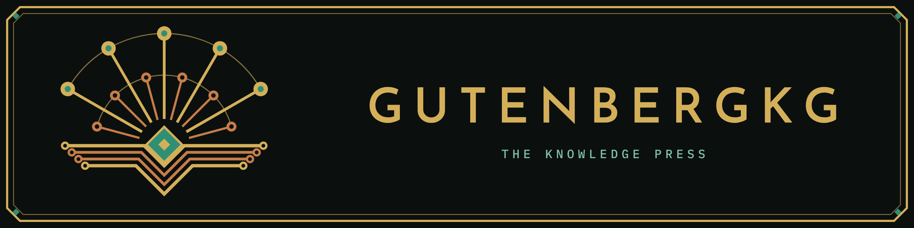

# GutenbergKG brand system



GutenbergKG's mark is an Art Techno drawing: an open book drawn as four traces
notched at the gutter, with a die in the gutter and a graph fan rising from it.
Text goes in at the book, and the knowledge graph comes out of the die. It
replaced the cybernetic-brain logo in November 2026.

Art Techno does for the computer age what Art Deco did for the machine age.
Its style rules, palette and motif lexicon are in the Art Techno repository,
[`docs/STYLE.md`](https://github.com/Flux-Frontiers/art_techno/blob/main/docs/STYLE.md).
The rules and marks the KG fleet shares are in diary_kg's
[`assets/brands.md`](https://github.com/Flux-Frontiers/diary_kg/blob/main/assets/brands.md).

## The files

All of them are written by [`scripts/build_logo.py`](../../scripts/build_logo.py).

| File | Size | Use |
| --- | --- | --- |
| [`assets/logos/gutenbergkg_banner.svg`](../logos/gutenbergkg_banner.svg), `.png` | 1280 x 320, PNG at 2560 x 640 | The README header. Display at up to 720 px wide. |
| [`assets/gutenbergkg_logo.svg`](../gutenbergkg_logo.svg), `.png` | 512 square, PNG at 1024 | The square mark with the name and tagline. Avatars, cards, title slides. |
| [`assets/logos/gutenbergkg_icon.svg`](../logos/gutenbergkg_icon.svg) | 64 square | The mark reduced for 64 px and below, with no lettering. |
| `assets/logos/logo_{512,256,128}.png` | as named | Cut from the mark. |
| `assets/logos/logo_{64,32}.png` | as named | Cut from the icon. |
| `assets/badges/badge_200.png` | 200 | Cut from the mark. |
| `assets/badges/badge_{80,40,20}.png` | as named | Cut from the icon. |
| `docs/assets/logo.png`, `docs/assets/favicon.png` | 256, 32 | The docs site's header logo and favicon, cut from the icon. |

## Using the mark

- **Name and tagline.** The name is GUTENBERGKG in Josefin Sans SemiBold
  capitals tracked +200, in gold. The tagline is THE KNOWLEDGE PRESS in IBM
  Plex Mono capitals, in mint. The lettering is outlined to paths, so the SVGs
  render the same everywhere, including on GitHub.
- **Ground.** The mark is drawn on obsidian `#0B100E` and carries its own
  ground, so it reads the same on light and dark pages. Never recolor it.
- **Small sizes.** At 64 px and below use the icon, never the full mark,
  whose lettering and hairlines do not survive.
- **Don't** stretch, outline, shadow, add glow to or rotate the mark, and
  don't reset the lettering in another face.

## Palette

The seven Art Techno tokens only:

| Token | Hex | Role in the mark |
| --- | --- | --- |
| Obsidian | `#0B100E` | Ground |
| Panel | `#121A17` | Chip packages |
| Copper | `#C77C48` | Inner page traces, inner graph rays |
| Gold | `#D4AF5A` | Frame, outer page traces, long rays, pads, the name |
| Solder green | `#2F8F74` | The die and pad cores, under 10% of area |
| Mint | `#7FBFA8` | The tagline |
| Silkscreen | `#EDE6D3` | Lettering on dark pages outside the mark |

## Changing the mark

Edit the motif, name or tagline in `scripts/build_logo.py` and rerun it from
the repository root:

```bash
python scripts/build_logo.py
```

It needs `fonttools` and Pillow, Google Chrome for the PNG renders, and a clone
of [`art_techno`](https://github.com/Flux-Frontiers/art_techno) beside this
repository. Set `CHROME` to the browser binary if it is not at the default
macOS path.

## Archive

[`archive/2026-08-brain/`](archive/2026-08-brain/) holds the August 2026 brand
board for the brain logo and the graph badges it proposed for each KG module.
It is kept for the record and no longer describes the mark.
